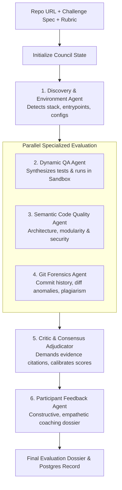

# Phase 2: Research - Agentic Evaluation Council

## 1. Problem Statement
The legacy AutoJudge evaluation was a sequential linear pipeline with deterministic, hardcoded heuristics:
1. **Code Quality**: Raw line counts and AST smell counters without understanding code semantics.
2. **Functionality**: Executed a single hardcoded dummy test (`test -> test`). It did not inspect the project's actual entrypoints, generate custom test suites, or verify challenge compliance.
3. **Originality**: Purely vector cosine similarity and static regex stripping.
4. **Scoring & Feedback**: Hardcoded if-else statements with canned template responses.

To become a market-leading commercial evaluation platform, AutoJudge requires **Agentic Autonomy**:
- The system must understand what a repository does based on its README and code.
- It must synthesize test cases on the fly to test real functionality.
- It must deliberate using an adversarial Critic agent to prevent hallucinations and ensure calibrated grading across thousands of submissions.

---

## 2. Multi-Agent Framework Architecture Evaluation

| Criterion | Heavy Framework (e.g. CrewAI / AutoGen) | LangGraph | Lightweight Typed State Graph (Native ReAct) |
| :--- | :--- | :--- | :--- |
| **Dependency Footprint** | Extremely heavy, rapid breaking changes | Moderate | Zero extra dependencies, uses existing Pydantic & typing |
| **Celery / Async Compatibility** | Difficult to serialize state across tasks | Moderate (requires LangGraph runtime) | Native; Pydantic state model is 100% JSON-serializable |
| **Determinism & Tracing** | Stochastic conversational loops | Graph state transitions | Graph state transitions with explicit step audit logs |
| **Execution Speed** | Slow (uncontrolled chat turns) | Fast | Sub-second state transitions |
| **Fault Tolerance & Checkpointing** | Complex | State snapshotting | Native database checkpointer |

### Decision:
Implement a **Typed State Graph Council (`CouncilGraph`)** powered by Pydantic and clean ReAct agent nodes:
- Native integration with Celery workers.
- Complete state inspection and event emission for real-time frontend streaming (SSE).
- Easily pluggable LLM backends (Anthropic Claude, OpenAI, Gemini, local Ollama).

---

## 3. Agent Council Roles & Interactions

### Detailed Agent Node Responsibilities:

#### Node 1: Reconnaissance & Environment Agent (`ReconAgent`)
- **Perceives**: Scans directory tree, reads README, inspects package manifests (`package.json`, `requirements.txt`, `pyproject.toml`, `Cargo.toml`).
- **Decides**: Identifies primary language, framework, API routes / CLI entrypoints, and runtime environment.
- **Output**: Writes `EnvironmentBlueprint` to council state.

#### Node 2: Dynamic QA & Test Synthesis Agent (`QAAgent`)
- **Perceives**: Reads the challenge prompt requirements and the entrypoints discovered by `ReconAgent`.
- **Decides**: Synthesizes structured `TestCaseInput` test cases covering:
  - Happy path functionality.
  - Edge cases (null inputs, boundary values, empty arrays).
  - Malicious / adversarial injections (testing resilience).
- **Acts**: Dispatches generated tests to the Phase 1 `BaseSandboxProvider`.
- **Output**: Writes `FunctionalityReport` and raw execution logs to council state.

#### Node 3: Semantic Code Quality Agent (`QualityAgent`)
- **Perceives**: Combines tree-sitter AST complexity metrics with semantic LLM code auditing.
- **Decides**: Evaluates architectural cohesion, separation of concerns, error handling, and security hygiene (e.g. hardcoded secrets, unprotected routes).
- **Output**: Writes `QualityAnalysis` with line-numbered citations.

#### Node 4: Git Forensics & Originality Agent (`ForensicsAgent`)
- **Perceives**: `git log` commit frequencies, author metadata, diff size distribution, and `pgvector` code snippet similarity.
- **Decides**: Flags projects developed in an unnatural burst (e.g., 10,000 lines committed 10 minutes before the deadline) or repos cloning standard boilerplate without attribution.
- **Output**: Writes `ForensicsReport` with similarity ratios and plagiarism flags.

#### Node 5: Critic & Consensus Adjudicator (`CriticAgent`)
- **Perceives**: Gathers the findings of QA, Quality, and Forensics.
- **Reflects**: Validates that all deductions are backed by line-numbered evidence or concrete sandbox failure logs. If an agent attempts to dock points without evidence, the Critic rejects the penalty.
- **Decides**: Produces normalized dimension scores (0-100) aligned with the challenge rubric weights.

#### Node 6: Participant Feedback Coach (`FeedbackCoach`)
- **Perceives**: Consensus score and verified findings.
- **Decides**: Produces an actionable, constructive feedback report separating judge-only technical dossiers from participant coaching (strengths, growth areas, recommended next steps).
