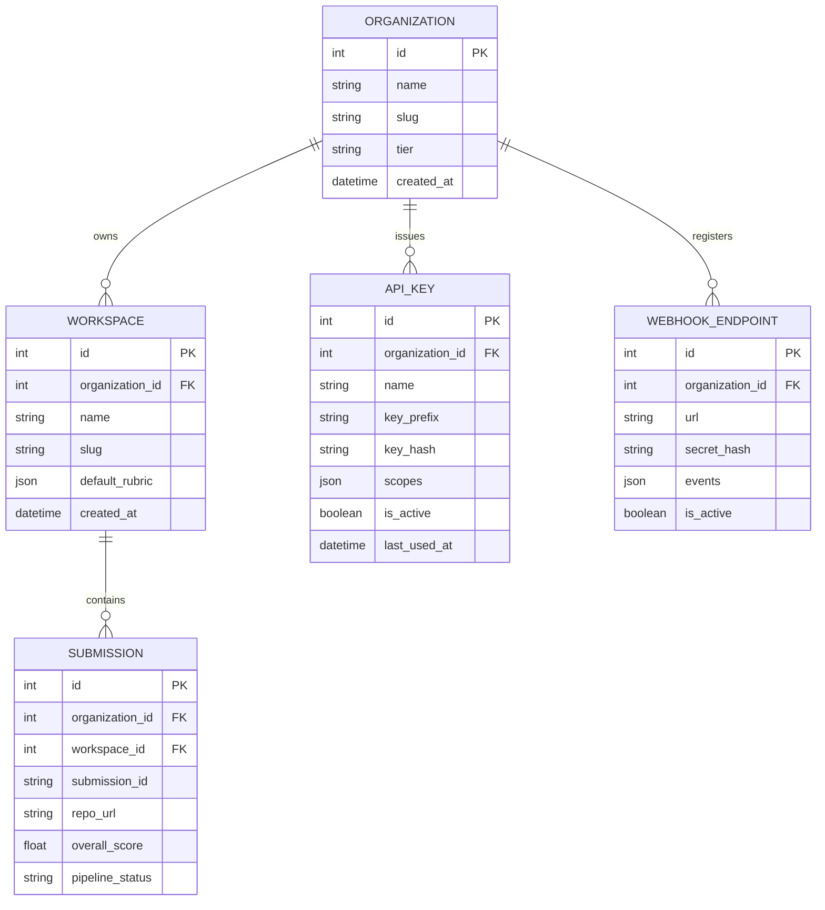

# Phase 3: Research - Multi-Tenancy, B2B Developer API & Webhooks

## 1. Problem Statement & Commercial Motivation
To sell AutoJudge as a service (B2B PaaS) to external platforms (Devpost, DoraHacks, HackerRank, universities, corporate hiring platforms), AutoJudge cannot remain a single-tenant local application.

Partners require:
1. **Multi-Tenancy & Data Isolation**: Each enterprise client must have an isolated Organization and Workspaces. Team submissions and rubrics from Client A must never be accessible to Client B.
2. **Programmatic API Access**: Systems must trigger evaluations via authenticated REST API requests without human UI involvement.
3. **API Key Security**: High-entropy cryptographically generated API keys (`ak_live_...`) with secure SHA-256 hash storage (the raw secret is only displayed once upon creation).
4. **Rate Limiting & Tier Governance**: Enforce throughput ceilings (e.g. 10 req/min for Free, 60 req/min for Pro) using Redis token-bucket rate limiting.
5. **Asynchronous Webhook Delivery**: Evaluations take 5–30 seconds. Third-party platforms must receive signed HMAC-SHA256 webhooks upon completion to update their own databases.

---

## 2. API Key Design (Stripe-Patterned)

Following industry standard API key architecture (Stripe, GitHub, OpenAI):
- **Key Format**: `ak_live_{prefix_8}_{secret_32}` (e.g. `ak_live_ab12cd34_98fbc89e31...`)
- **Key Prefix (Public)**: Stored in plaintext for identification and fast indexing in DB.
- **Key Hash**: Stored in DB as `SHA-256(secret)` with salt or HMAC. The plaintext key is NEVER stored in plaintext in the database.
- **Scopes / Permissions**: Fine-grained capability checks (`eval:read`, `eval:write`, `eval:admin`).

```
Request: Authorization: Bearer ak_live_xxxx...
   │
   ▼
Extract Prefix ──► Query ApiKey by prefix
   │
   ▼
Compute SHA-256(key) ──► Compare with stored key_hash (constant-time)
   │
   ▼
Resolve Organization & Workspace ──► Inject into Request Context
```

---

## 3. Webhook Delivery & Anti-Replay Architecture

When an evaluation finishes, AutoJudge notifies the partner platform via a signed HTTP POST:
- **Headers**:
  - `Content-Type: application/json`
  - `X-AutoJudge-Timestamp`: Epoch timestamp (seconds)
  - `X-AutoJudge-Signature`: `t={timestamp},v1={hmac_sha256(secret, f"{timestamp}.{raw_body}")}`
- **Anti-Replay Protection**: The receiving platform verifies that `abs(now - timestamp) < 300` seconds to prevent replay attacks.
- **Payload Schema**:
  ```json
  {
    "event": "evaluation.completed",
    "timestamp": "2026-11-24T15:00:00Z",
    "data": {
      "submission_id": "sub_101",
      "overall_score": 87.5,
      "verdict": "ACCEPTED_EXCELLENT",
      "dimensions": { ... },
      "participant_feedback": { ... }
    }
  }
  ```

---

## 4. Multi-Tenant Database Architecture


